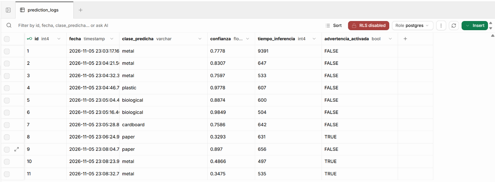
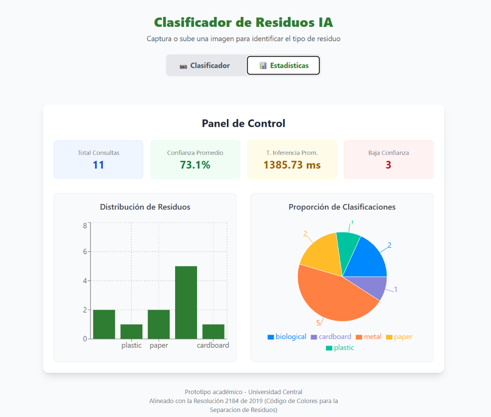
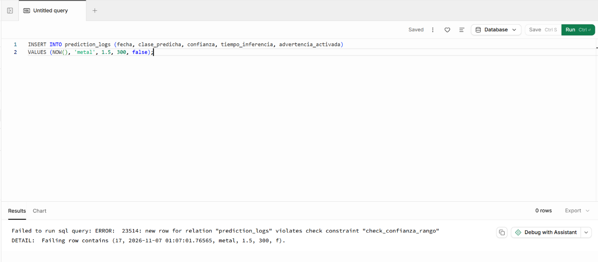
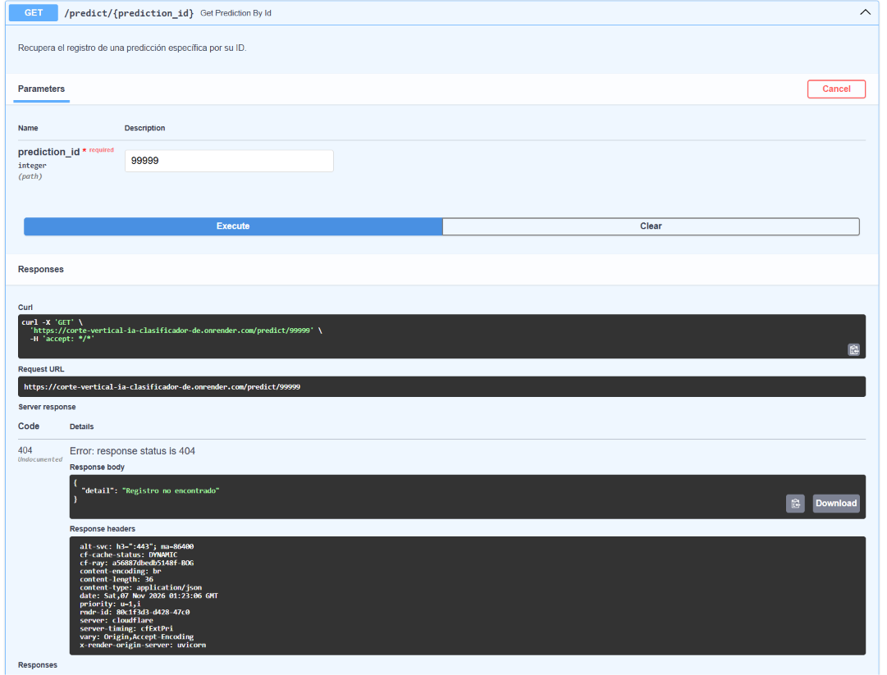
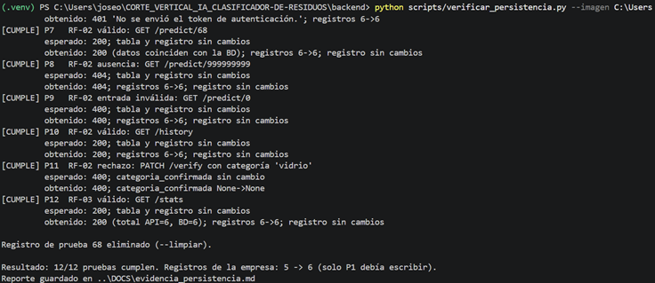

<div align="center">
  <h1> Corte Vertical: Arquitectura de Sistemas I</h1>
  <p><strong>Clasificador de Residuos IA con Persistencia y Módulo Estadístico </strong></p>
  
  <!-- Badges / Insignias -->
  <p>
    
    
    
    
    
    <br/>
    
    
    
    
    
  </p>
</div>

---

## 🌐 Link:https://corte-vertical-ia-clasificador-de-r.vercel.app/

## 🫡 Integrantes:Jose Camilo Oyola , Juan David Villa , Juan Caucayo

---

---

## 📖 1. Descripción del Corte Vertical

Este repositorio contiene la implementación del **Corte Vertical** para la asignatura de **Arquitectura de Sistemas I**. El proyecto original consistía en un prototipo web para clasificar residuos mediante Inteligencia Artificial (sin base de datos).

Para este corte, la arquitectura evolucionó de un modelo **Stateless** (sin estado) a un modelo **Stateful** (con estado), integrando una capa de persistencia en la nube y un módulo de observabilidad . El nuevo flujo transversal atraviesa todas las capas del sistema:

1.  **Captura:** El usuario sube o toma una foto desde el frontend .
2.  **Inferencia:** El backend (FastAPI) procesa la imagen con MobileNetV2.
3.  **Persistencia:** Se guardan los metadatos de la predicción en **Supabase** (PostgreSQL).
4.  **Observabilidad:** El usuario puede acceder a un Dashboard estadístico que consume los datos agregados de la base de datos.

---

## 🏗️ 2. Diagrama de Componentes

El sistema sigue un patrón **Cliente-Servidor desacoplado** en la nube:


---

---

## 📋 3. Plantilla de Alcance del Corte Vertical (Guia Semana 12) -Actualizada

| Elemento                                     | Descripción del Grupo                                                                                                                                                                                                                                                                                                           |
| :------------------------------------------- | :------------------------------------------------------------------------------------------------------------------------------------------------------------------------------------------------------------------------------------------------------------------------------------------------------------------------------ |
| **Funcionalidad priorizada**                 | Clasificación de un residuo dentro de 5 categorías (cartón, papel, metal, plásticos, orgánicos), persistencia del historial de consultas y visualización estadística en un panel con la viabilidad del modelo.                                                                                                                  |
| **Actor principal**                          | Usuario final y Administrador técnico.                                                                                                                                                                                                                                                                                          |
| **Capa de presentación prevista**            | Aplicación web en React. Incluye el componente de captura, la tarjeta de resultados y un nuevo módulo de Dashboard con gráficas (usando librerías como Recharts).                                                                                                                                                               |
| **Endpoint(s) requeridos**                   | 1. `POST /predict` (Recibe la imagen, clasifica, guarda el registro en BD y retorna el JSON).<br>2. `GET /stats` (Recupera los datos agregados de la base de datos para las gráficas).                                                                                                                                          |
| **Servicio(s) de aplicación o negocio**      | 1. **Preprocesamiento:** Validación y transformación de la imagen.<br>2. **Inferencia:** Ejecución del modelo MobileNetV2.<br>3. **Persistencia:** Registro asíncrono de los metadatos en la base de datos.<br>4. **Agregación Estadística:** Consultas agrupadas para calcular promedios de confianza y frecuencias por clase. |
| **Regla de negocio principal**               | **Umbral de Ética Algorítmica:** Si la probabilidad es < 60%, el sistema alerta al usuario.<br>**Regla de Privacidad (Ley 1581 de 2012):** El sistema persiste el resultado y metadatos (fecha, clase, nivel de confianza), pero NUNCA almacena la imagen del residuo ni datos personales.                                      |
| **Repositorio o componente de persistencia** | Base de Datos Relacional. El modelo `.keras` sigue actuando como repositorio estático de IA.                                                                                                                                                                                                                                    |
| **Tabla(s) o colección(es) involucradas**    | Tabla `prediction_logs` (historical_predicciones).                                                                                                                                                                                                                                                                              |
| **Validaciones mínimas**                     | **Frontend:** Tipo de archivo y tamaño.<br>**Backend:** Imagen no corrupta.<br>**BD:** Restricciones de tipo de datos (ej. confianza entre 0.0 y 1.0).                                                                                                                                                                          |
| **Qué sí se implementaría**                  | - Flujo completo de captura y envío.<br>- Inferencia de IA en 5 categorías.<br>- Persistencia segura en BD.<br>- Endpoint de consulta de métricas.<br>- Gráficas en el frontend (histogramas de confianza y distribución de clases).                                                                                            |

---

## 📖 4.Link Matriz y Verificacion de Requerimientos: [Matriz y Verificacion de Requerimientos](DOCS/Matriz%20y%20verificacion%20de%20requerimientos.pdf)

---

## 🧪 5.Pruebas de Persistencia y Base de Datos (Guia Semana 13)

### 1. Requisitos y Configuración

- **Base de Datos:** PostgreSQL (Alojada en Supabase).
- **ORM:** SQLAlchemy 2.0.0
- **Driver:** psycopg2-binary 2.9.9
- **Tabla:** `prediction_logs`

### 1.1 Patrón Repositorio (Separación de Responsabilidades)

Se implementó el archivo `app/crud.py` para encapsular las consultas SQL y las escrituras en la base de datos. En `app/routes.py` ahora solo estan las llamadas y no contienen sentencias SQLAlchemy, usando asi el principio de responsabilidad única.

### 2. Prueba de Escritura (Write)

- **Endpoint:** `POST /predict`
- **Acción:** Enviar una imagen de prueba .
- **Resultado Esperado:** Respuesta HTTP 200 con JSON de predicción. Un nuevo registro debe insertarse en la tabla `prediction_logs`.
- **Evidencia:**
  

### 3. Prueba de Lectura y Agregación (Read)

- **Endpoint:** `GET /stats`
- **Acción:** Acceder al Dashboard desde el frontend .
- **Resultado Esperado:** Respuesta HTTP 200 con el conteo de clases y promedios. La gráfica de pastel debe renderizar los datos.
- **Evidencia:**
  

### 4. Prueba de Integridad de Datos

- **Objetivo:** Validar que la base de datos rechaza datos inconsistentes (ej. un nivel de confianza mayor a 1.0) directamente a nivel de motor de base de datos.
- **Ejecución:** En el SQL Editor de Supabase, se intentó insertar un registro con `confianza = 1.5`.
  ```sql
  INSERT INTO prediction_logs (fecha, clase_predicha, confianza, tiempo_inferencia, advertencia_activada)
  VALUES (NOW(), 'metal', 1.5, 300, false);
  ```
- **Evidencia:**
  

### 5. Manejo de Identificadores Inexistentes

- **Objetivo:** Validar que el sistema responde controladamente (HTTP 404) cuando se busca un recurso que no existe.
- **Ejecución:** Consumir el endpoint `GET /predict/99999` (un ID que no está en la BD).
- 1. Abrimos el backend/app/crud.py y agregamos esta función al final:

```def get_prediction_by_id(db: Session, prediction_id: int):
    """Busca una predicción por su ID. Retorna None si no existe."""
    return db.query(models.PredictionLog).filter(models.PredictionLog.id == prediction_id).first()
```

- 2. Abrimos backend/app/routes.py y agregamos esta ruta (puede ser debajo del endpoint /stats):

```@router.get("/predict/{prediction_id}", tags=["Clasificación"])
async def get_prediction_by_id(prediction_id: int, db: Session = Depends(get_db)):
    """Recupera el registro de una predicción específica por su ID."""
    log = crud.get_prediction_by_id(db, prediction_id)
    if not log:
        # Aquí ocurre la prueba de calidad: en lugar de fallar, responde con un 404 controlado
        raise HTTPException(
            status_code=status.HTTP_404_NOT_FOUND,
            detail="Registro no encontrado"
        )
    return log
```

- **Resultado Obtenido:** El servidor retornó un código HTTP 404 con el JSON `{"detail": "Registro no encontrado"}`.
- **Evidencia:**
  

### 6. Rendimiento y Volumen

- **Objetivo:** Demostrar que el panel de estadistica no se pone lento aunque haya muchos datos.
- **Ejecución:** Verificar el endpoint `GET/stats` y verificar el tiempo de respuesta.
- 1. Abrimos el SQL Editor de Supabase y ejecutamos en el siguiente codigo para inyectar datos masivos:

```INSERT INTO prediction_logs (fecha, clase_predicha, confianza, tiempo_inferencia,      advertencia_activada)
    SELECT NOW(), 'plastic', random(), 250, false FROM generate_series(1, 1000);
```

- **Resultado Obtenido:** Por medio de un captura del Chrome DevTools , se verifica un tiempo de respuesta de 195ms (Un tiempo excelente teniendo en cuenta que esta consultando mas de 1000 registros) del endpoint `GET/stats`.
- **Evidencia:**
  

---

## 🔄 Modificación: Evolución a Plataforma Empresarial Sencilla

Como parte de la evolución del proyecto, la arquitectura se transformó de un sistema **"Stateless"** a una **Plataforma Multiempresa Sencilla**. A continuación, se detallan las modificaciones y nuevas funcionalidades implementadas en esta fase.

### 1. Autenticación y Seguridad (JWT)

- **Proveedor de Identidad:** Se integró **Supabase Auth** para el registro e inicio de sesión.
- **Protección del Backend:** Todos los endpoints críticos (`/predict`, `/stats`, `/history`) ahora están protegidos. El backend (`auth.py`) intercepta la petición, valida la firma criptográfica del Token JWT y extrae el `user_id` del usuario.
- **Roles:** La base de datos soporta la asignación de roles (`administrador`, `supervisor`, `empleado`).

### 2. Aislamiento de Datos

- **Modelo Relacional:** Se amplió la base de datos en Supabase creando las tablas `companies` (empresas) y `company_members` (relación usuario-empresa). La tabla `prediction_logs` ahora incluye llaves foráneas (`company_id`, `user_id`).
- **Regla de Negocio Crítica (RNF-33):** El backend identifica la empresa del usuario logueado a través del token y **filtra absolutamente todas las consultas SQL** (estadísticas, historial) por ese `company_id`. Un usuario de la "Empresa A" jamás podrá ver los datos de la "Empresa B".

### 3. Nuevos Endpoints Implementados

- `POST /register-company`: Registra una nueva empresa y asocia automáticamente al usuario creador como administrador.
- `GET /company-info`: Devuelve el nombre de la empresa del usuario autenticado para mostrarlo dinámicamente en el frontend.
- `GET /history`: Retorna el historial paginado de clasificaciones, filtrado por empresa.
- `PATCH /predict/{id}/verify`: Permite guardar la categoría corregida por un humano.

### 4. Verificación Humana

- Se modificó el módulo de Historial en el frontend. Ahora, si una predicción de la IA tiene una confianza menor al 60%, el usuario puede hacer clic en **"Revisar"**, seleccionar la categoría correcta en un menú desplegable y **"Guardar"**.
- Esto actualiza la columna `categoria_confirmada` en la base de datos (manteniendo intacta la predicción original de la IA), sentando las bases para el reentrenamiento del modelo.

### 5. Header Dinámico

- El frontend ya no muestra un nombre de empresa genérico. Consume el endpoint `/company-info` al iniciar sesión y renderiza el nombre real de la organización en la cabecera principal junto al correo del usuario.

### 6. Escenario de Prueba Inyectado

Para validar la arquitectura, se inyectaron datos de prueba directamente en Supabase:

- **3 Empresas:** Recicladora del Norte, EcoVerde S.A.S., Gestión Ambiental Bogotá.
- **6 Usuarios (2 por empresa):** Con roles de `admin`, `supervisor` y `employee`.
- **60 Predicciones:** 20 registros por cada empresa con fechas y confianzas aleatorias.

---

---

## 🧩 6. Lógica de negocio y API del corte vertical (Guía Semana 14)

### 6.1 Arquitectura en capas del backend

Flujo de cada petición: **API → Servicio de aplicación → Repositorio → Base de datos**.

| Capa                    | Ubicación                                      | Responsabilidad                                                                                                                                                                                                                |
| :---------------------- | :--------------------------------------------- | :----------------------------------------------------------------------------------------------------------------------------------------------------------------------------------------------------------------------------- |
| API (controladores)     | `backend/app/routes.py`                        | Recibe HTTP, valida el formato (imagen, tipos) y delega en el servicio. No contiene reglas ni SQL.                                                                                                                             |
| Servicios de aplicación | `backend/app/services/`                        | Reglas de negocio de cada RF. No dependen de HTTP ni de SQLAlchemy: reciben el repositorio por inyección.                                                                                                                      |
| Errores de negocio      | `backend/app/services/exceptions.py`           | `EntradaInvalida` (400), `UsuarioSinEmpresa` (403), `RecursoNoEncontrado` (404), `Conflicto` (409), `ErrorInferencia` / `ErrorPersistencia` / `ErrorConsulta` (500). `app/main.py` los traduce a HTTP con `{"detail": "..."}`. |
| Repositorio             | `backend/app/crud.py` (`PredictionRepository`) | Encapsula todas las consultas SQLAlchemy y las transacciones (`commit` / `rollback`).                                                                                                                                          |

### 6.2 Servicios y endpoints por requerimiento funcional

| RF                                                                    | Prioridad | Endpoint(s)                                                                                                                                                                   | Servicio y método                                                                                                                    | Métodos del repositorio                                                                     | Reglas / condiciones                                                                                                                                                                                                                                     |
| :-------------------------------------------------------------------- | :-------- | :---------------------------------------------------------------------------------------------------------------------------------------------------------------------------- | :----------------------------------------------------------------------------------------------------------------------------------- | :------------------------------------------------------------------------------------------ | :------------------------------------------------------------------------------------------------------------------------------------------------------------------------------------------------------------------------------------------------------- |
| **RF-01** Clasificar un residuo a partir de una imagen (5 categorías) | Alta      | `POST /predict`                                                                                                                                                               | `ClasificacionService.clasificar`                                                                                                    | `get_company_id_for_user`, `create_prediction_log`                                          | Imagen JPG/PNG/WEBP ≤ 5 MB y decodificable; el usuario debe pertenecer a una empresa; advertencia si la confianza es < 0,60; la respuesta exitosa se envía **después** de confirmar el guardado.                                                         |
| **RF-02** Almacenar y consultar el historial de clasificaciones       | Alta      | Escritura: `POST /predict` (compartido con RF-01)<br>Consulta: `GET /history`, `GET /predict/{prediction_id}`<br>Verificación humana: `PATCH /predict/{prediction_id}/verify` | `ClasificacionService.clasificar` (escritura)<br>`HistorialService.listar`, `HistorialService.obtener`, `HistorialService.verificar` | `create_prediction_log`, `get_company_history`, `get_prediction_by_id`, `verify_prediction` | Se registran fecha y hora, categoría, confianza, tiempo y advertencia; **nunca la imagen** (Ley 1581 de 2012). ID entero positivo; `skip ≥ 0`, `1 ≤ limit ≤ 100`; categoría confirmada dentro de las 5 clases; solo registros de la empresa del usuario. |
| **RF-03** Panel estadístico                                           | Alta      | `GET /stats`                                                                                                                                                                  | `EstadisticasService.resumen`                                                                                                        | `get_company_id_for_user`, `get_prediction_stats`                                           | Métricas calculadas solo con los registros de la empresa: total, cantidad y porcentaje por categoría, confianza promedio, tiempo promedio y advertencias.                                                                                                |

> RF-01 y RF-02 comparten el endpoint `POST /predict`: una sola clasificación produce el resultado (RF-01) y el registro en el historial (RF-02). La guía lo permite ("varios RF pueden compartir componentes").
>
> **Ajuste de alcance de RF-03:** la "evolución de las consultas en el tiempo" queda fuera del alcance de este corte. El panel presenta la cantidad y la distribución por categoría.

Endpoints de soporte (no son RF, pero los habilitan): `POST /register-company` y `GET /company-info` → `EmpresaService`.

### 6.3 Pruebas unitarias de los servicios

Las pruebas de `backend/tests/test_services.py` sustituyen el repositorio por uno simulado y el modelo por un predictor falso, así que no abren conexiones a la base de datos ni cargan TensorFlow:

```bash
cd backend
python -m pytest tests -v
```

### 6.4 Contratos del API

**Convenciones comunes a todos los endpoints**

- **URL base local:** `http://localhost:8000` · Documentación interactiva: `http://localhost:8000/docs`.
- **Autenticación:** todos los endpoints de los RF exigen el encabezado `Authorization: Bearer <access_token de Supabase>`.
- **JSON** con nombres en `snake_case`; fechas en ISO 8601; IDs enteros generados por el backend.
- **Estructura única de error:** `{"detail": "<mensaje>"}`. Los errores esperados (400, 401, 403, 404, 409, 413) se distinguen de un fallo interno (500). El 500 se registra en el log del servidor y responde un mensaje genérico, sin detalles técnicos.

| Código | Cuándo ocurre (común a todos los endpoints)                              | `detail`                                            |
| :----- | :----------------------------------------------------------------------- | :-------------------------------------------------- |
| 400    | Falta un campo, tipo incorrecto o ID no numérico (validación de FastAPI) | `Solicitud inválida. Verifique los datos enviados.` |
| 401    | No se envió el token                                                     | `No se envió el token de autenticación.`            |
| 401    | Token inválido o expirado                                                | `Token inválido.` / `El token ha expirado`          |
| 403    | El usuario autenticado no pertenece a ninguna empresa                    | `El usuario no está asociado a ninguna empresa.`    |
| 500    | Error inesperado                                                         | `Ocurrió un error interno. Intente de nuevo.`       |

**Resumen de contratos por endpoint**

| RF                        | Método y ruta                           | Entrada                                                         | Éxito                                                         | Errores específicos (además de 401 y 403)                                                                                                     | Servicio                          |
| :------------------------ | :-------------------------------------- | :-------------------------------------------------------------- | :------------------------------------------------------------ | :-------------------------------------------------------------------------------------------------------------------------------------------- | :-------------------------------- |
| RF-01 (+ escritura RF-02) | `POST /predict`                         | `multipart/form-data`, campo `file`: imagen JPG/PNG/WEBP ≤ 5 MB | **201** con la clasificación y `id_prediccion`                | 400 sin archivo, formato no permitido o imagen corrupta; 413 > 5 MB; 500 fallo del modelo o del guardado (no se responde 201 si no se guardó) | `ClasificacionService.clasificar` |
| RF-02                     | `GET /history?skip=0&limit=50`          | Query: `skip` ≥ 0, `1 ≤ limit ≤ 100`                            | **200** `{total, records[]}`, del más reciente al más antiguo | 400 `skip` o `limit` fuera de rango                                                                                                           | `HistorialService.listar`         |
| RF-02                     | `GET /predict/{prediction_id}`          | Ruta: ID entero positivo; sin cuerpo                            | **200** con el registro                                       | 400 ID ≤ 0 o no numérico; 404 no existe o es de otra empresa                                                                                  | `HistorialService.obtener`        |
| RF-02                     | `PATCH /predict/{prediction_id}/verify` | Ruta: ID; JSON `{"categoria_correcta": "<clase>"}`              | **200** con la categoría confirmada                           | 400 ID inválido, campo ausente o categoría fuera de las 5 clases; 404 no existe                                                               | `HistorialService.verificar`      |
| RF-03                     | `GET /stats`                            | Sin parámetros                                                  | **200** con las métricas de la empresa                        | —                                                                                                                                             | `EstadisticasService.resumen`     |

#### RF-01 — `POST /predict`

```http
POST /predict
Authorization: Bearer <token>
Content-Type: multipart/form-data

file=<residuo.jpg>
```

```json
HTTP 201 Created
{
  "clase": "plastic",
  "clase_etiqueta": "Plástico",
  "confianza": 0.9132,
  "probabilidades": {"biological": 0.0105, "cardboard": 0.0213, "metal": 0.0281, "paper": 0.0269, "plastic": 0.9132},
  "color_disposicion": "blanco",
  "advertencia": false,
  "modelo": "MobileNetV2",
  "tiempo_inferencia_ms": 187,
  "timestamp": "2026-11-14T19:15:09.257145+00:00",
  "id_prediccion": 1
}
```

`advertencia` es `true` cuando `confianza < 0.60`. `id_prediccion` es el ID real del registro guardado en el historial (RF-02); la imagen no se almacena.

| Escenario                                     | Respuesta                                                                                                      |
| :-------------------------------------------- | :------------------------------------------------------------------------------------------------------------- |
| Archivo `.txt` (`text/plain`)                 | `400 {"detail": "Formato no permitido. Use JPG, PNG o WEBP."}`                                                 |
| Archivo con extensión de imagen pero corrupto | `400 {"detail": "La imagen no pudo ser procesada. Verifique que el archivo sea válido."}`                      |
| Petición sin el campo `file`                  | `400 {"detail": "Solicitud inválida. Verifique los datos enviados."}`                                          |
| Imagen de 6 MB                                | `413 {"detail": "El archivo supera el tamaño máximo de 5 MB."}`                                                |
| Usuario sin empresa                           | `403 {"detail": "El usuario no está asociado a ninguna empresa."}` (no se ejecuta el modelo ni se guarda nada) |
| Falla el modelo                               | `500 {"detail": "Ocurrió un error interno en la IA."}` (no se guarda nada)                                     |
| El modelo responde pero falla el guardado     | `500 {"detail": "No se pudo guardar el registro de la clasificación."}`                                        |

#### RF-02 — `GET /history`, `GET /predict/{prediction_id}`, `PATCH /predict/{prediction_id}/verify`

La escritura del historial ocurre en `POST /predict`. Estas operaciones lo consultan atravesando API → servicio → repositorio, siempre filtradas por la empresa del usuario.

```json
GET /history?skip=0&limit=10

HTTP 200 OK
{
  "total": 1,
  "records": [
    {
      "id": 1,
      "fecha": "2026-11-14T19:15:09.253054",
      "clase_predicha": "plastic",
      "confianza": 0.9132,
      "tiempo_inferencia": 187,
      "advertencia_activada": false,
      "categoria_confirmada": null,
      "company_id": 1,
      "user_id": "<uuid del usuario>"
    }
  ]
}
```

```json
GET /predict/1

HTTP 200 OK
{"id": 1, "fecha": "2026-11-14T19:15:09.253054", "clase_predicha": "plastic", "confianza": 0.9132, "tiempo_inferencia": 187, "advertencia_activada": false, "categoria_confirmada": null, "company_id": 1, "user_id": "<uuid del usuario>"}
```

```json
PATCH /predict/1/verify
Content-Type: application/json
{"categoria_correcta": "plastic"}

HTTP 200 OK
{"message": "Predicción verificada correctamente", "categoria_confirmada": "plastic"}
```

| Escenario                                                       | Respuesta                                                                                          |
| :-------------------------------------------------------------- | :------------------------------------------------------------------------------------------------- |
| `GET /predict/999999` (ID válido inexistente o de otra empresa) | `404 {"detail": "Registro no encontrado o no pertenece a su empresa."}`                            |
| `GET /predict/0`                                                | `400 {"detail": "El ID de la predicción debe ser un entero positivo."}`                            |
| `GET /predict/abc`                                              | `400 {"detail": "Solicitud inválida. Verifique los datos enviados."}`                              |
| `GET /history?limit=500`                                        | `400 {"detail": "El parámetro 'limit' debe estar entre 1 y 100."}`                                 |
| `GET /history?skip=-1`                                          | `400 {"detail": "El parámetro 'skip' no puede ser negativo."}`                                     |
| `PATCH .../verify` con `"vidrio"`                               | `400 {"detail": "Categoría no válida. Use una de: biological, cardboard, metal, paper, plastic."}` |
| `PATCH .../verify` sin cuerpo                                   | `400 {"detail": "Solicitud inválida. Verifique los datos enviados."}`                              |
| `PATCH /predict/999999/verify`                                  | `404 {"detail": "Registro no encontrado o no pertenece a su empresa."}`                            |

#### RF-03 — `GET /stats`

```json
GET /stats

HTTP 200 OK
{
  "total_consultas": 1,
  "confianza_promedio_global": 0.9132,
  "tiempo_inferencia_promedio_ms": 187.0,
  "total_advertencias_baja_confianza": 0,
  "distribucion_clases": [
    {"clase": "plastic", "cantidad": 1, "porcentaje": 100.0}
  ]
}
```

| Escenario                       | Respuesta                                                          |
| :------------------------------ | :----------------------------------------------------------------- |
| Empresa sin clasificaciones     | `200` con `total_consultas: 0` y `distribucion_clases: []`         |
| Usuario sin empresa             | `403 {"detail": "El usuario no está asociado a ninguna empresa."}` |
| Falla la consulta de agregación | `500 {"detail": "Error al calcular las estadísticas."}`            |

> Los ejemplos se obtuvieron ejecutando el backend real (con el modelo y la autenticación sustituidos en una base de prueba). Las fechas, los IDs y los valores de confianza cambian en cada ejecución.

### 6.5 Verificación de persistencia real y ausencia de escrituras indebidas

**Objetivo.** Demostrar, contra la base de datos real (Supabase/PostgreSQL), que:

1. Lo que el API confirma como creado queda guardado y se recupera igual desde **otra conexión**, distinta a la del API.
2. Los rechazos (400, 401, 404, 413) **no dejan registros huérfanos**, y las consultas (`GET`) **no modifican datos**.

**Herramienta.** `backend/scripts/verificar_persistencia.py` llama al API por HTTP, como el frontend, y después de cada paso consulta la tabla `prediction_logs` con una conexión SQLAlchemy propia. Cuenta los registros de la empresa antes y después, y compara el registro creado campo por campo.

**Estado inicial.** Backend corriendo en `http://localhost:8000`, conectado a la misma base que usa el script, y un usuario asociado a una empresa (fila en `company_members`).

**Cómo ejecutarlo (PowerShell, desde `backend/`):**

```powershell
# Token del usuario: en la app, F12 -> Console:
# JSON.parse(localStorage.getItem(Object.keys(localStorage).find(k => k.includes('auth-token')))).access_token
$env:API_TOKEN = "<access_token>"
python scripts/verificar_persistencia.py --imagen ruta\a\residuo.jpg --salida ..\DOCS\evidencia_persistencia.md
```

- `DATABASE_URL` se toma de `backend/.env`, la misma base que usa el API.
- `--limpiar` borra al final el único registro que crea la prueba P1. Así la prueba se puede repetir sin acumular datos.
- El script termina con código 0 si todas las pruebas cumplen y con 1 si alguna falla.

**Escenarios verificados**

| Prueba | RF             | Acción                                      | Verificación en la BD (otra conexión)                                                                             |
| :----- | :------------- | :------------------------------------------ | :---------------------------------------------------------------------------------------------------------------- |
| P1     | RF-01 válido   | `POST /predict` con una imagen              | 201 con ID real; +1 registro; clase, confianza, tiempo, advertencia, empresa y usuario coinciden con la respuesta |
| P2     | RF-01 rechazo  | Archivo `.txt`                              | 400; mismo número de registros antes y después                                                                    |
| P3     | RF-01 rechazo  | Imagen corrupta                             | 400; sin registro huérfano                                                                                        |
| P4     | RF-01 rechazo  | Petición sin archivo                        | 400; sin registro huérfano                                                                                        |
| P5     | RF-01 rechazo  | Imagen de 6 MB                              | 413; sin registro huérfano                                                                                        |
| P6     | RF-01 rechazo  | Sin token                                   | 401; sin registro huérfano                                                                                        |
| P7     | RF-02 válido   | `GET /predict/{id}` del registro creado     | 200; los datos coinciden con la BD; el registro no cambia                                                         |
| P8     | RF-02 ausencia | `GET /predict/999999999`                    | 404; la tabla no cambia                                                                                           |
| P9     | RF-02 entrada  | `GET /predict/0`                            | 400; la tabla no cambia                                                                                           |
| P10    | RF-02 válido   | `GET /history`                              | 200; la tabla no cambia                                                                                           |
| P11    | RF-02 rechazo  | `PATCH /predict/{id}/verify` con `"vidrio"` | 400; `categoria_confirmada` no cambia                                                                             |
| P12    | RF-03 válido   | `GET /stats`                                | 200; `total_consultas` igual al conteo de la BD; la tabla no cambia                                               |

**Resultado obtenido:** ver [`DOCS/evidencia_persistencia.md`](DOCS/evidencia_persistencia.md), el reporte generado por el script con fecha, base de datos, conteos y resultado de cada prueba.

**Verificación Persistencia  Mediante Terminal**

 

**Complementos**

- Las pruebas unitarias (§6.3) verifican, sin base de datos, que el servicio **no invoca el guardado** cuando el usuario no tiene empresa o el modelo falla, y que las consultas solo leen (`assert_not_called`).
- La restricción `CHECK (confianza >= 0.0 AND confianza <= 1.0)` rechaza datos inconsistentes directamente en el motor de base de datos (§5, prueba 4).
- Transacciones: `crud.py` hace `commit` tras cada escritura y `rollback` si falla; `POST /predict` responde 201 solo después de confirmar el guardado.
