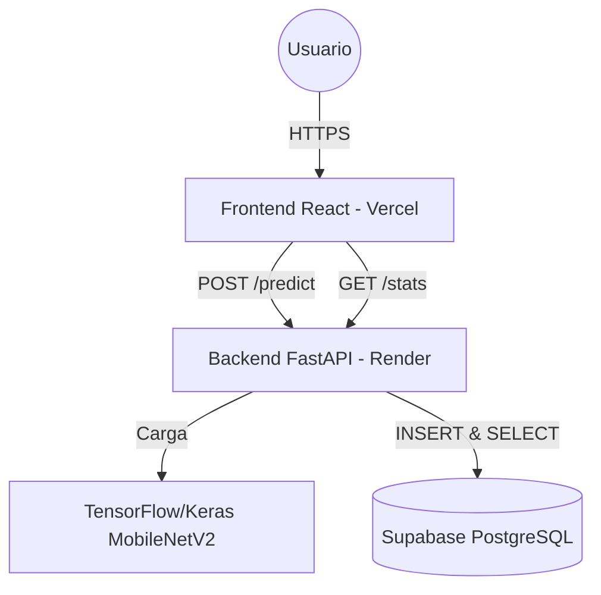
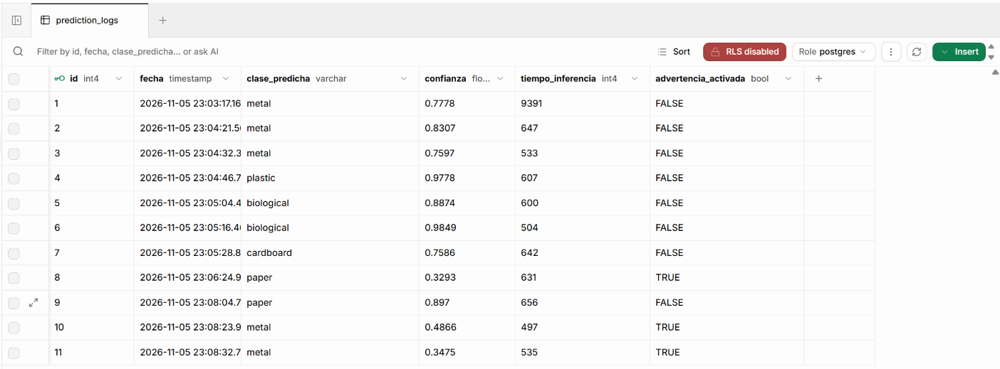
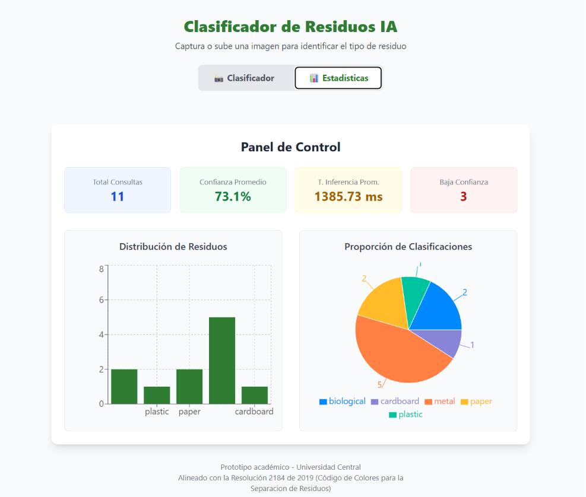

  <h1> Corte Vertical: Arquitectura de Sistemas I</h1>
  
<strong>Clasificador de Residuos IA con Persistencia y Módulo Estadístico </strong>

  
  <!-- Badges / Insignias -->
  

    
    
    
    
    
     
    
    
    
    
    
  

---
## 🌐 Link:https://corte-vertical-ia-clasificador-de-r.vercel.app/

## 🫡 Integrantes:Jose Camilo Oyola , Juan David Villa , Juan Caucayo
---

---

## 📖 1. Descripción del Corte Vertical

Este repositorio contiene la implementación del **Corte Vertical** para la asignatura de **Arquitectura de Sistemas I**. El proyecto original consistía en un prototipo web para clasificar residuos mediante Inteligencia Artificial (sin base de datos). 

Para este corte, la arquitectura evolucionó de un modelo **Stateless** (sin estado) a un modelo **Stateful** (con estado), integrando una capa de persistencia en la nube y un módulo de observabilidad . El nuevo flujo transversal atraviesa todas las capas del sistema:

1.  **Captura:** El usuario sube o toma una foto desde el frontend .
2.  **Inferencia:** El backend (FastAPI) procesa la imagen con MobileNetV2.
3.  **Persistencia:** Se guardan los metadatos de la predicción en **Supabase** (PostgreSQL).
4.  **Observabilidad:** El usuario puede acceder a un Dashboard estadístico que consume los datos agregados de la base de datos.

---

## 🏗️ 2. Arquitectura del Sistema

El sistema sigue un patrón **Cliente-Servidor desacoplado** en la nube:

---

---

## 📋 3. Plantilla de Alcance del Corte Vertical (Guia Semana 12)

| Elemento | Descripción del Grupo |
| :--- | :--- |
| **Funcionalidad priorizada** | Clasificación de un residuo dentro de 5 categorías (cartón, papel, metal, plásticos, orgánicos), persistencia del historial de consultas y visualización estadística en un panel con la viabilidad del modelo. |
| **Actor principal** | Usuario final y Administrador técnico. |
| **Capa de presentación prevista** | Aplicación web en React. Incluye el componente de captura, la tarjeta de resultados y un nuevo módulo de Dashboard con gráficas (usando librerías como Recharts). |
| **Endpoint(s) requeridos** | 1. `POST /predict` (Recibe la imagen, clasifica, guarda el registro en BD y retorna el JSON). 2. `GET /stats` (Recupera los datos agregados de la base de datos para las gráficas). |
| **Servicio(s) de aplicación o negocio** | 1. **Preprocesamiento:** Validación y transformación de la imagen. 2. **Inferencia:** Ejecución del modelo MobileNetV2. 3. **Persistencia:** Registro asíncrono de los metadatos en la base de datos. 4. **Agregación Estadística:** Consultas agrupadas para calcular promedios de confianza y frecuencias por clase. |
| **Regla de negocio principal** | **Umbral de Ética Algorítmica:** Si la probabilidad es < 60%, el sistema alerta al usuario. **Regla de Privacidad (Ley 1581 de 2012):** El sistema persiste el resultado y metadatos (fecha, clase, nivel de confianza), pero NUNCA almacena la imagen del residuo ni datos personales. |
| **Repositorio o componente de persistencia** | Base de Datos Relacional. El modelo `.keras` sigue actuando como repositorio estático de IA. |
| **Tabla(s) o colección(es) involucradas** | Tabla `prediction_logs` (historical_predicciones). |
| **Validaciones mínimas** | **Frontend:** Tipo de archivo y tamaño. **Backend:** Imagen no corrupta. **BD:** Restricciones de tipo de datos (ej. confianza entre 0.0 y 1.0). |
| **Qué sí se implementaría** | - Flujo completo de captura y envío. - Inferencia de IA en 5 categorías. - Persistencia segura en BD. - Endpoint de consulta de métricas. - Gráficas en el frontend (histogramas de confianza y distribución de clases). |

---

## 🧪 4.Pruebas de Persistencia y Base de Datos (Guia Semana 13)

### 1. Requisitos y Configuración
- **Base de Datos:** PostgreSQL (Alojada en Supabase).
- **ORM:** SQLAlchemy 2.0.0
- **Driver:** psycopg2-binary 2.9.9
- **Tabla:** `prediction_logs`

### 1.1 Patrón Repositorio (Separación de Responsabilidades)
Se implementó el archivo `app/crud.py` para encapsular las consultas SQL y las escrituras en la base de datos. En `app/routes.py` ahora solo estan las llamadas y no contienen sentencias SQLAlchemy, usando asi  el principio de responsabilidad única.

### 2. Prueba de Escritura (Write)
- **Endpoint:** `POST /predict`
- **Acción:** Enviar una imagen de prueba .
- **Resultado Esperado:** Respuesta HTTP 200 con JSON de predicción. Un nuevo registro debe insertarse en la tabla `prediction_logs`.
- **Evidencia:**
 .

### 3. Prueba de Lectura y Agregación (Read)
- **Endpoint:** `GET /stats`
- **Acción:** Acceder al Dashboard desde el frontend .
- **Resultado Esperado:** Respuesta HTTP 200 con el conteo de clases y promedios. La gráfica de pastel debe renderizar los datos.
- **Evidencia:** 
.

---