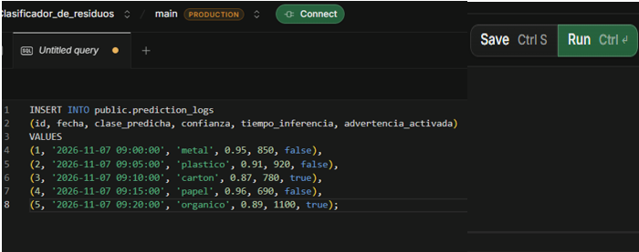
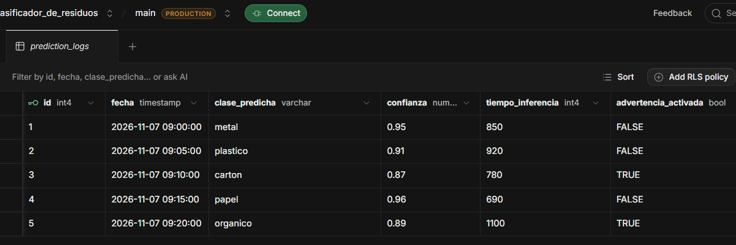

# Reproducción de la base de datos

## Requisitos

- Acceso a un proyecto de Supabase.
- Permisos para ejecutar consultas SQL.
- Acceso a los archivos `schema.sql` y `seed.sql`.

## Procedimiento

1. Ingresar al proyecto de Supabase.
2. Abrir SQL Editor.
3. Ejecutar el contenido de `schema.sql` para crear la tabla `prediction_logs`.

 

4. Ejecutar el contenido de `seed.sql` para insertar los registros de prueba.

 

5. Ejecutar una consulta SELECT para comprobar los registros almacenados.

## Verificación

```sql
SELECT *
FROM public.prediction_logs
ORDER BY id;
```

 

La reconstrucción se considera satisfactoria cuando la tabla existe, contiene los datos de prueba y permite realizar las consultas necesarias para el historial y el módulo estadístico.

## Estado inicial esperado

- Tabla: `prediction_logs`.
- Cantidad inicial de registros: 5.
- Categorías de prueba: metal, plástico, cartón, papel y orgánico.
